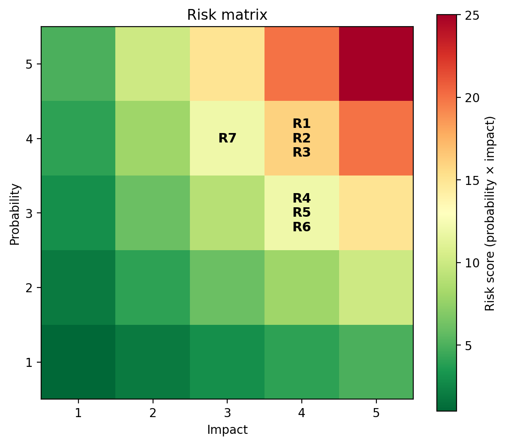
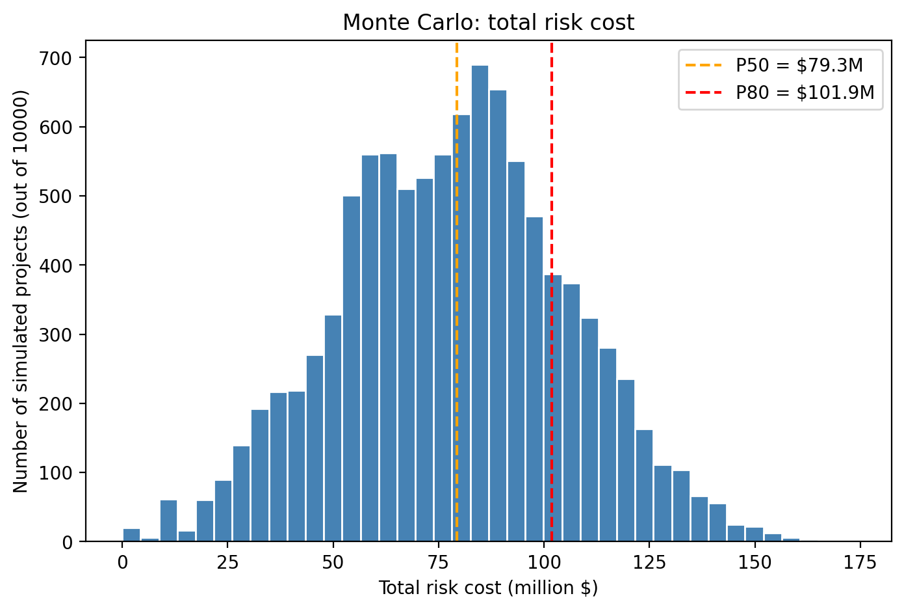

# Construction Risk Analyzer

A Python tool that reads a construction project's risk register from a CSV file, rates every risk, places them on a risk matrix, and runs a Monte Carlo simulation to estimate how much contingency (money and time) the project should set aside.

I built it as a second-year civil engineering student at McGill University, while learning Python, to understand how project managers and estimators actually quantify risk. I tested it on a **real, published risk register**: the Anchorage Port Modernization Project.



---

## Why I built this

On construction projects, a risk matrix tells you **which** risks matter most, but not **how much** money and time to put aside for them. You can't just add up every risk's cost (they won't all happen), and the average is too optimistic. This tool answers both questions:

1. **Which risks matter most?** Each risk gets a probability score, an impact score and a band (Low, Medium, High, Critical).
2. **How much contingency is needed?** A Monte Carlo simulation plays the project out 10,000 times and gives the P50 and P80 cost and delay.

---

## What it does

- **Loads a risk register** from a CSV file (made in Excel)
- **Rates probability** from a yearly chance, over the project's duration
- **Rates impact on three dimensions** (cost, delay, safety) and keeps the worst one
- **Uses official CNESST injury categories** (Quebec) for the safety rating
- **Prints a report** for each risk, a text risk matrix and a legend
- **Draws a colour heat map** of the risk matrix (matplotlib)
- **Runs a Monte Carlo simulation** (10,000 runs) and reports the expected risk cost, P50 and P80 for cost and delay, with a histogram

---

## Case study: Anchorage Port Modernization Project

The US Army Corps of Engineers published a cost and schedule risk analysis for this project (**Concept A, December 2014**): a base cost of about **$541M** and an **84-month** schedule, with a detailed risk register. I entered the 7 risks from that register that have a dollar and month impact in `Anchorage_port_RISKS.csv`. Every row cites its source.

Source: [Anchorage Port Modernization Project, Appendix A, Cost and Schedule Risk Analysis](https://www.portofalaska.com/wp-content/uploads/AppendixA-CostEstimate.pdf)

**How I translated the register into my format**

- **Probability:** the register gives the chance over the whole project ("Likely" = 7 in 10, "Unlikely" = 3 in 10). My tool expects a yearly chance, so I converted them: 70% over 7 years = **15.8% per year**, and 30% = **5.0% per year**.
- **Delay:** months × about 21.7 working days, with no float (the register gives the delay to the project directly).
- **Cost:** the register's rough dollar impact, used as the direct cost. Weekly overhead and penalties are set to 0 so the delay isn't counted twice.
- **Safety:** the register doesn't rate safety, so every risk is "no injury".

**Risk ratings**

| ID | Risk | Probability | Impact | Score |
|---|---|---|---|---|
| R1 | CON-8 Historic change order growth | 70% → 4 | 4 ($25M, 4.6% of budget) | **16 → High** |
| R2 | EST-1 Insufficient or uncertain future funding | 70% → 4 | 4 ($20M) | **16 → High** |
| R3 | PPM-4 Project execution | 70% → 4 | 4 ($25M) | **16 → High** |
| R4 | CON-4 Poor construction quality / hidden defects | 30% → 3 | 4 ($25M) | **12 → High** |
| R5 | PR-3 Acts of God (earthquake, severe weather) | 30% → 3 | 4 (1-year delay = 14% of schedule) | **12 → High** |
| R6 | CON-6 Vessel schedule disruptions | 30% → 3 | 4 ($20M) | **12 → High** |
| R7 | TL-6 Port operations vs. construction phasing | 70% → 4 | 3 ($10M, 1.8% of budget) | **12 → High** |

All 7 come out High because they are the register's most important risks (I only kept risks rated Moderate or High with numerical impacts). My tool ranks the **same three risks at the top** as the official register: change order growth, funding and project execution.

**Monte Carlo results (10,000 runs)**

| | Result |
|---|---|
| Expected risk cost | $72.6M |
| P50 risk cost | $79.3M |
| **P80 risk cost (contingency)** | **$101.9M (18.8% of the base budget)** |
| P50 delay | 18.7 months |
| **P80 delay** | **27.2 months: 111 months total instead of 84** |



**What the histogram shows:** the simulated risk cost ranges from almost $0 to over $150M. The P50 ($79.3M) is higher than the expected value ($72.6M), so a contingency based on the average alone would be exceeded in more than half of the simulated projects. That's why percentiles like P80 are used to set contingency.

**Comparison with the official analysis**

| | My model | Official report |
|---|---|---|
| P80 schedule | 111 months | 108 months |
| P80 cost contingency | 18.8% | 23% |

My schedule result lands within 3 months of the professional analysis, and the cost contingency is in the same range but lower. That makes sense: I used only 7 of the register's risks, while the official analysis covers the full register and the uncertainty in the cost estimate itself. It's a sanity check of my method, not a replacement for a professional analysis.

---

## Second example: mid-size residential building

I first built and tested the tool on `Montreal_building_Peel_RISKS.csv`, a realistic example project ($14M, 2 years, two risks). **Its values are illustrative estimates, not records from a real company.** Result: the general construction strike scores **3 → Low**, contaminated soil scores **20 → Critical**, and the P80 risk contingency is **$1.24M (8.9% of budget)**. To run it, change the file name in the `open(...)` line and in `MC_CSV_FILE`.

---

## How it works

**1. Probability over the project**
The CSV gives a yearly chance `p`. Over a project of `T` years:

```
P(at least once) = 1 − (1 − p)^T
```

| Score | Label | Chance over the project |
|---|---|---|
| 1 | Rare | under 10% |
| 2 | Unlikely | 10–30% |
| 3 | Possible | 30–50% |
| 4 | Likely | 50–70% |
| 5 | Almost certain | 70% or more |

**2. Impact: three dimensions, keep the worst**

| Score | Cost (% of budget) | Delay (% of project duration) | Safety (CNESST category) |
|---|---|---|---|
| 1 | under 0.5% | under 2% | first aid / no injury |
| 2 | 0.5–1% | 2–5% | accident without lost time |
| 3 | 1–3% | 5–10% | accident with lost time |
| 4 | 3–5% | 10–25% | serious accident (LSST art. 62) |
| 5 | over 5% | 25% or more | death |

- **Delay** = (activity delay − float) ÷ working days per week, i.e. only the part of a delay that the schedule's float can't absorb.
- **Cost** = direct cost + delay weeks × weekly site overhead + penalties.
- Cost and delay are rated **as a % of the project's budget and duration**, so the same scale works for a $14M building or a $541M port. I first rated delay in weeks and found it made every risk on the port project look critical, so I changed it.

**3. Score and band**
Score = probability × impact (1 to 25). Bands: 1–4 Low, 5–9 Medium, 10–16 High, 20–25 Critical.

**4. Monte Carlo**
For each of 10,000 runs, every risk "rolls the dice" against its probability. If it happens, its cost and delay vary between 75% and 150% of the estimate (triangular distribution, most likely 100%). The totals of all runs are sorted, and P50 and P80 are read from them.

---

## How to run it

**Requirements:** Python 3 and matplotlib (`pip install matplotlib`, or in Thonny: Tools → Manage packages).

1. Put the CSV file in the same folder as `risk_analyzer.py`.
2. Check the file name in the `open(...)` line and in `MC_CSV_FILE` (both are set to `Anchorage_port_RISKS.csv`).
3. Run `risk_analyzer.py`.

**CSV columns**

| Column | Meaning |
|---|---|
| Risk Name | name of the risk |
| Probability(%) | chance per year |
| Duration of project(years) | project duration |
| Situation description | CNESST safety term (e.g. `no injury`, `lost-time injury`, `décès`) |
| Activity Delay (Days) | working days of delay if the risk happens |
| Total Slack Days | float available on that activity |
| Direct Cost ($) | cost of the extra work |
| Weekly overhead ($) | site costs per extra week |
| penalties ($) | contract penalties |
| Budget ($) | project budget |

Save the file from Excel as **CSV UTF-8**, so French accents stay readable.

---

## Project structure

```
risk_analyzer.py                    the program
Anchorage_port_RISKS.csv            real public register (main case study)
Montreal_building_Peel_RISKS.csv    example building project
risk_matrix.png                     risk matrix heat map (Anchorage)
monte_carlo_cost.png                Monte Carlo cost histogram (Anchorage)
```

---

## Assumptions and limitations

- **Scale boundaries are illustrative.** Standards like ISO 31000 and PMI define the method, not the numbers; each organization calibrates its own scales.
- **Risks are treated as independent.** In reality some move together (the Anchorage register itself has a column for correlated risks).
- **Delays add up**, as if every risk hits the critical path, which is conservative.
- **The 75%–150% variation range** is an assumption, not measured data.
- **The Anchorage case uses only the register's 7 risks with numerical impacts**, and the building example's values are estimates.

---

## What's next

- Evaluate the same risks under several organizations' scales and recommend the best fit for the project size
- Model correlated risks and add a sensitivity (tornado) chart
- Optimize which risk responses to fund (linear programming)
- Update risks automatically from daily and weekly site reports

---

## What I learned

- **Risk management:** probability and impact scales, the worst-dimension rule, critical path and float, contingency, P50/P80, and why a model is only as good as its assumptions
- **Python:** functions with parameters and multiple returns, loops and `enumerate`, lists of lists, reading CSV files with `csv.DictReader`, f-string formatting, matplotlib, and the `random` module
- **Habits:** keeping input separate from calculation, testing every function with values I could check by hand, and catching silent bugs that give wrong results without any error

---

## AI use

I learned Python on this project with Claude (Anthropic's AI assistant) as a tutor and code reviewer. I wrote the core of the program myself: the rating functions, the CSV loading, the report and the risk grid. At my request, the AI supplied the `evaluate_risk` function, the matrix printing and legend, the delay-scale update, the heat map and the Monte Carlo block, and it helped research sources. A detailed AI use log, listing exactly what I wrote and what the AI contributed, is available on request.

---

**Abdelhalim (Halim) Shahin**, civil engineering student, McGill University
